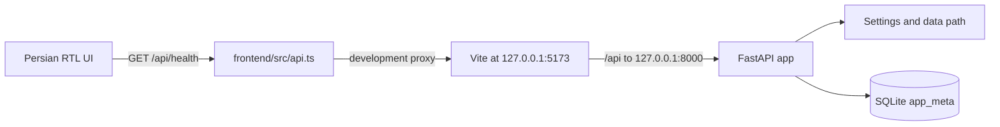

# SupportRecall code map

This map describes the Stage 1 skeleton. Import, retrieval, and generation modules will be added in their authorized stages.

## Request flow

In Compose, the browser still calls the relative `/api/health` path. Nginx forwards it to the `backend` service on port 8000. The backend creates the SQLite file during application startup, and the health route checks that storage is ready.

## Main files

| Area | File | Responsibility |
|---|---|---|
| API entry point | `backend/app/main.py` | Creates FastAPI, initializes storage during lifespan, and returns the typed health response. |
| Backend settings | `backend/app/settings.py` | Resolves `SUPPORTRECALL_DATA_DIR` or defaults to the project `data/` directory. |
| Persistence | `backend/app/storage.py` | Creates and checks the SQLite database and `app_meta` schema marker. |
| Backend checks | `backend/tests/test_health.py` | Verifies initialization, exact health JSON, and reuse of existing database contents. |
| UI entry point | `frontend/src/main.tsx` | Mounts the React application and its styles. |
| UI shell | `frontend/src/App.tsx` | Renders Persian navigation, empty states, backend status, retry, and the three Stage 1 views. |
| API client | `frontend/src/api.ts` | Calls the same-origin health route and validates its response. |
| Persian copy | `frontend/src/strings.ts` | Holds the application labels, status text, empty-state copy, and accessible names. |
| UI styling | `frontend/src/styles.css` | Defines layout, responsive behavior, right-to-left friendly styling, colors, and focus states. |
| Frontend checks | `frontend/src/App.test.tsx` | Checks the real relative API path, connected/disconnected/retry UI, storage states, and navigation. |
| Dev server | `frontend/vite.config.ts` | Configures React, Tailwind, Vitest, and the local `/api` proxy. |
| Static server | `frontend/nginx.conf` | Serves the built UI on port 8080 and proxies `/api/` to the backend service. |
| Containers | `backend/Dockerfile`, `frontend/Dockerfile`, `compose.yaml` | Build the API and frontend, provide healthchecks, and declare named storage volumes. |

## Persistence and configuration

- Local mode defaults to `data/supportrecall.sqlite3`; set `SUPPORTRECALL_DATA_DIR` to change the directory.
- Compose sets the data path to `/app/data` and mounts the `app-data` named volume there.
- Compose also declares named `uploads`, `vectors`, and `model-cache` volumes for later stages. Those stores are not used yet.
- `OLLAMA_BASE_URL` is present in the Compose environment for later integration. Stage 1 does not call it or require Ollama.

## Planned code areas

The approved design describes later source parsing and import, retrieval and vector storage, model adapters, prompts, and citations. Those features are not part of this skeleton yet. Their modules and data contracts will be mapped here as the stages are authorized and implemented.
