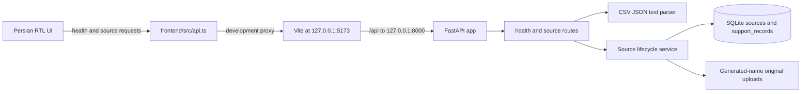

# SupportRecall code map

This map describes the Stage 2 import and inspection workflow. Retrieval and answer generation remain future stages.

## Request flow

In Compose, the browser still calls relative `/api` paths. Nginx forwards them to the `backend` service on port 8000. The backend creates or migrates the SQLite file during application startup, recovers interrupted sources as retryable failures, and stores original uploads separately from normalized conversation records.

## Main files

| Area | File | Responsibility |
|---|---|---|
| API entry point | `backend/app/main.py` | Creates FastAPI, initializes storage during lifespan, and returns the typed health response. |
| Backend settings | `backend/app/settings.py` | Resolves `SUPPORTRECALL_DATA_DIR` or defaults to the project `data/` directory. |
| Persistence | `backend/app/storage.py` | Creates and migrates the SQLite database; preserves the Stage 1 metadata schema and creates source/record tables. |
| Import parsers | `backend/app/imports/parsers.py` | Decodes and validates Persian or English CSV headers, two JSON schemas, and the documented Persian text format. |
| Source routes | `backend/app/routes/sources.py` | Handles preview, import, list, detail, retry, and delete endpoints with structured Persian errors; the UI confirms deletions. |
| Source lifecycle | `backend/app/sources.py` | Enforces upload and record limits; saves original bytes; deduplicates normalized content; persists ordered records and statuses; recovers and retries imports. |
| Backend checks | `backend/tests/test_health.py`, `backend/tests/test_import_parsers.py`, `backend/tests/test_sources.py` | Verifies health, parser formats and validation, additive migration, persistence, deduplication, retry recovery, and deletion cleanup. |
| UI entry point | `frontend/src/main.tsx` | Mounts the React application and its styles. |
| UI shell | `frontend/src/App.tsx` | Renders Persian navigation, backend status, and selects the chat, knowledge, or settings view. |
| Knowledge workflow | `frontend/src/KnowledgeView.tsx` | Provides samples, upload/drop, CSV mapping, server preview, import confirmation, source details, retry, and confirmed deletion. |
| API client | `frontend/src/api.ts` | Calls the same-origin health and source routes and maps structured server errors to Persian copy. |
| Persian copy | `frontend/src/strings.ts` | Holds the application labels, status text, validation/errors, confirmations, and accessible names. |
| UI styling | `frontend/src/styles.css` | Defines shell and import workflow styling, responsive behavior, RTL-friendly mixed text, colors, and focus states. |
| Frontend checks | `frontend/src/App.test.tsx`, `frontend/src/KnowledgeView.test.tsx` | Checks health/navigation and the Persian upload-to-inspection workflow, including mapping, errors, retry, and deletion. |
| Dev server | `frontend/vite.config.ts` | Configures React, Tailwind, Vitest, and the local `/api` proxy. |
| Static server | `frontend/nginx.conf` | Serves the built UI on port 8080 and proxies `/api/` to the backend service. |
| Containers | `backend/Dockerfile`, `frontend/Dockerfile`, `compose.yaml` | Build the API and frontend, provide healthchecks, and declare named storage volumes. |
| Format guide and samples | `docs/IMPORT_FORMATS.md`, `frontend/public/samples/` | Documents the supported Persian-oriented schemas and provides synthetic CSV, JSON, and text downloads. |

## Persistence and configuration

- Local mode defaults to `data/supportrecall.sqlite3`; set `SUPPORTRECALL_DATA_DIR` to change the directory.
- Local uploads default to `<data_dir>/uploads`; set `SUPPORTRECALL_UPLOADS_DIR` to override that location.
- Compose sets the data path to `/app/data`, mounts the `app-data` volume there, and mounts the persistent `uploads` volume at `/app/uploads`.
- Stage 2 uses the uploads volume for retryable original files. The `vectors` and `model-cache` volumes are reserved for later stages.
- `OLLAMA_BASE_URL` is present in the Compose environment for later integration. Stage 2 does not call it or require Ollama.

## Data flow and limits

Preview reads and validates a file without adding a source. Import parses it again, stores the original under a generated ID-based filename, then saves normalized conversations and messages in SQLite. A canonical hash prevents duplicate sources. Files are limited to 5 MiB and 2,000 conversations; preview and detail responses show at most 20 conversations. Deletion removes the SQLite source and its records, then removes the original upload.

Retrieval, vector storage, model adapters, prompts, and citations remain future stages; their modules and data contracts will be mapped here when implemented.
