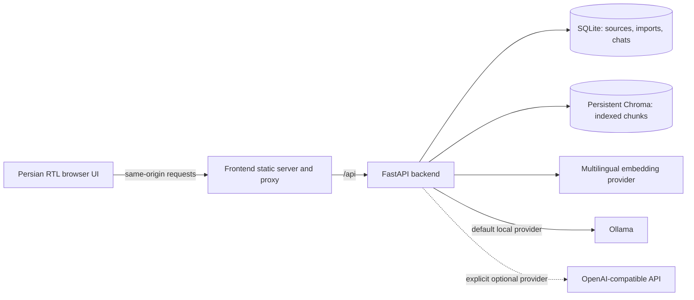

# SupportRecall design proposal

**Status:** Approved for Stage 1 on 2026-10-30  
**Prepared:** 2026-10-30  
**Scope:** Local, single-user support knowledge assistant

## Intent

SupportRecall will help a support operator answer new questions by retrieving relevant passages from uploaded historical conversations, then generating a Persian-first answer with inspectable source excerpts. New conversations become usable through ingestion and indexing; the language model is not fine-tuned.

The first data and evaluation examples will be synthetic. Real customer messages will not be sent to an external provider unless the user deliberately configures one.

## Goals and constraints

- Deliver a working Persian UI, backend, and retrieval-augmented generation flow.
- Preserve question/answer relationships, conversation order, source metadata, and stable citations through import and retrieval.
- Support English and Persian evidence and questions. Default generated answers to Persian, unless a different response language is requested.
- Keep the code small, readable, and configurable. Use conventional modules and thin API routes.
- Persist source records, chat sessions, vector data, and model caches through ordinary restarts and container recreation.
- Start the interface and basic health endpoint even when Ollama or a generation model is unavailable.
- Keep credentials on the backend. Bind published ports to host loopback by default.
- Do not fine-tune models, require a GPU, download models, call paid services, publish, commit, or push without authorization.

## Approaches considered

### Selected: the guide's FastAPI and React stack

Use Python/FastAPI for API and application logic; React, TypeScript, and Vite for the UI; SQLite for metadata and chats; and persistent local Chroma for vectors. Use a replaceable multilingual embedding adapter, with Sentence Transformers as the planned default, and Ollama as the default generation provider. An OpenAI-compatible provider remains an explicit, backend-configured option.

This is the user's selected approach. It supports a complete responsive UI, keeps retrieval and provider logic easy to locate, and follows the supplied implementation guide. It has more build tooling than a server-rendered Python UI, but better fits the requested chat, knowledge management, and settings screens.

### Considered: one Python-served application

FastAPI could serve both the API and a lighter server-rendered interface, with retrieval in the same Python process. This would reduce frontend tooling, but departs from the requested React/TypeScript default and makes the planned interactive UI less direct. It is not the selected approach.

## Proposed architecture

### Application flow

1. The knowledge screen previews and validates CSV, JSON, or the documented text format. CSV fields are mapped in the UI.
2. Import creates a source record and a recoverable pending/processing/ready/failed state. Parsers preserve message order, speaker, question/answer relationships, and available metadata without guessing dates.
3. Bounded, overlapping chunks retain useful conversational context and stable source references. Content hashes or stable identifiers detect duplicate imports.
4. SQLite stores source/import metadata, chat sessions, and records. Chroma stores embeddings and source-linked chunk metadata. Retry and reconciliation handle failures across the two stores; deleting a source removes both its records and vectors.
5. For a chat turn, the backend uses relevant prior chat context to interpret a follow-up, embeds the question, retrieves configurable top-k chunks, applies a relevance cutoff, and builds a bounded prompt with explicit source IDs.
6. The generator receives untrusted retrieved text as evidence, not instructions. The backend validates citation IDs against the retrieved set and returns the answer plus original excerpts and metadata. Missing evidence, provider errors, and conflicts receive clear Persian guidance.
7. Chat history is persisted separately and is never ingested automatically as support knowledge.

### Folder and configuration shape

Keep a conventional, compact layout: a Python `backend/` package, a React `frontend/` app, root Docker/Compose and environment files, and `docs/` for the design, progress log, code map, customization guide, import schemas, and operating instructions. Routes, parsing/ingestion, retrieval, generation prompts/providers, and settings each have clear homes without a generic plugin framework.

Backend settings live in one documented module. Configuration precedence will be: explicitly set environment values, persisted user-editable non-secret settings, then documented defaults. Secrets and trusted provider endpoints stay in backend configuration; the UI may select from supported configured providers but cannot submit arbitrary endpoints through chat. Persian interface copy lives in one small module, not a localization framework.

The finished repo will include `.env.example`, ignore rules, pinned dependency manifests/lockfiles, `docs/CODE_MAP.md`, and `docs/CUSTOMIZATION.md`. Model names, chunking, top-k, relevance cutoff, and paths will be configurable rather than scattered constants.

## Docker and local execution

- `compose.yaml` will run a backend and a multi-stage-built frontend. The frontend static server will proxy `/api` to the Compose service named `backend`, so browser requests stay same-origin and never use an internal Docker hostname.
- Named volumes will hold SQLite/application data, uploaded sources, Chroma data, and embedding-model cache. A separate optional Ollama profile may hold Ollama data.
- The default deployment will use an existing host Ollama service. On Docker Desktop for Windows, the backend will reach the host through `host.docker.internal`; Linux instructions will use `host-gateway` mapping where needed. The backend will not use container `localhost` to find host Ollama.
- Ollama will be optional for container startup. Health and readiness will distinguish an available backend from unavailable embedding/generation providers. No model download will be part of ordinary startup.
- Publish the UI on host loopback by default, run containers as non-root where practical, keep secrets in runtime environment, and include health checks.
- Keep a Windows-friendly non-Docker workflow. Document start, stop, logs, rebuild, backup/restore, and the destructive effect of `docker compose down -v`; never remove persistent volumes automatically.

## Model and resource plan

The embedding default will be a configurable multilingual Sentence Transformers model. `intfloat/multilingual-e5-base` is a candidate; its query/document formatting requirements will be respected if selected. An alternative worth evaluating is the already-installed Ollama `embeddinggemma:latest`. Do not silently mix representations: persist the embedding model identity and dimensions, and require a clear reindex when they change. The Stage 3 English/Persian evaluation will decide whether the chosen candidate is suitable; no embedding model will be downloaded before authorization.

Ollama is the default generator. The machine currently has `embeddinggemma:latest`, `gemma4:12b`, and `qwen3.5:9b` locally available. These are observed local models, not a promise that they are the final defaults; Persian answer quality, citation behavior, speed, and memory use still need a real integration check. An OpenAI-compatible provider is optional and must be explicitly configured because support text may leave the machine.

At inspection, Windows reported Python 3.14.7, Node 24.21.0, npm 11.19.0 (`npm.cmd` works in this PowerShell setup), 31.3 GB total RAM with 14.5 GB free, an AMD Ryzen 7 H 255 CPU, and an NVIDIA GeForce RTX 5060 Laptop GPU. GPU memory capacity was not inspected. CPU operation is a requirement; embeddings and generation may be slower without GPU acceleration. Actual model latency and resource use will be measured before recommending a local model size. Ollama 0.34.0 is installed. `uv` is not currently on PATH.

Current official guidance is consistent with the installed runtimes: FastAPI examples require Python 3.10+; Sentence Transformers recommends Python 3.10+ with PyTorch 2.2+; PyTorch's Windows install page lists Python 3.10–3.14; and Vite requires Node 20.19+ or 22.12+. Chroma supports local embedded Python usage and its current documentation includes Python 3.14 packaging support. Resolve and pin exact dependency versions during Stage 1, then verify the lock and image builds rather than assuming compatibility from version floors alone.

References checked for this proposal:

- [FastAPI version and dependency guidance](https://fastapi.tiangolo.com/deployment/versions/)
- [Sentence Transformers installation requirements](https://sbert.net/docs/installation.html)
- [PyTorch Windows installation requirements](https://pytorch.org/get-started/locally/)
- [Chroma installation and local Python usage](https://cookbook.chromadb.dev/core/install/)
- [Vite Node.js requirements](https://vite.dev/guide/)
- [Docker Desktop host-service networking](https://docs.docker.com/desktop/features/networking/networking-how-tos/)
- [EmbeddingGemma multilingual model card](https://ai.google.dev/gemma/docs/embeddinggemma/model_card)

## Security and reliability boundaries

- Validate file type, filename, size, record count, fields, and content; reject path traversal and unsafe inputs.
- Sanitize Markdown output. Never display raw provider errors or private support messages in routine logs.
- Treat uploaded instructions as untrusted; constrain prompts and citations to retrieved context. Valid source IDs do not prove every claim is supported.
- Keep chat sessions separate from source records. Make provider status and external-data use visible.
- Treat old support answers as potentially outdated. Surface conflicting or weak evidence instead of presenting it as certain.
- Initial use is local and single-user. Public hosting requires authentication and additional deployment hardening and is out of scope.

## Non-goals

No fine-tuning, autonomous agents, billing, public deployment, enterprise multi-tenancy, real customer data, mandatory GPU, or mandatory containerized Ollama. No notebook or static UI as the final product.
